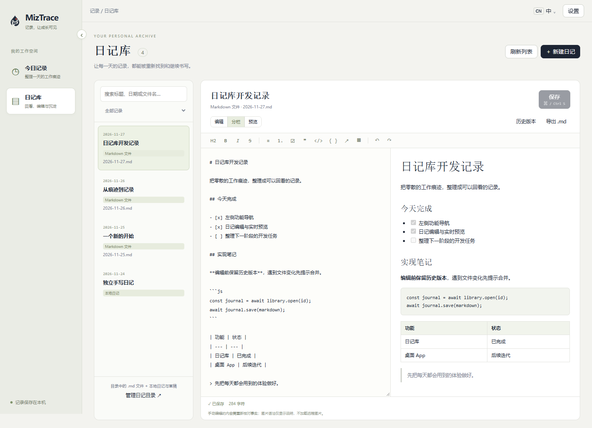
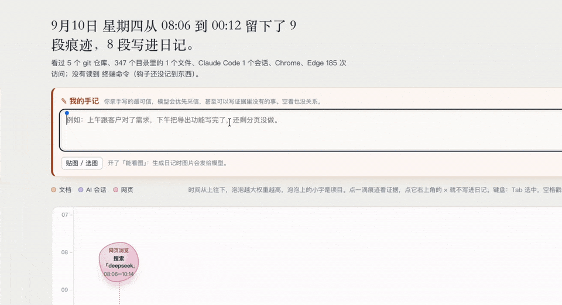
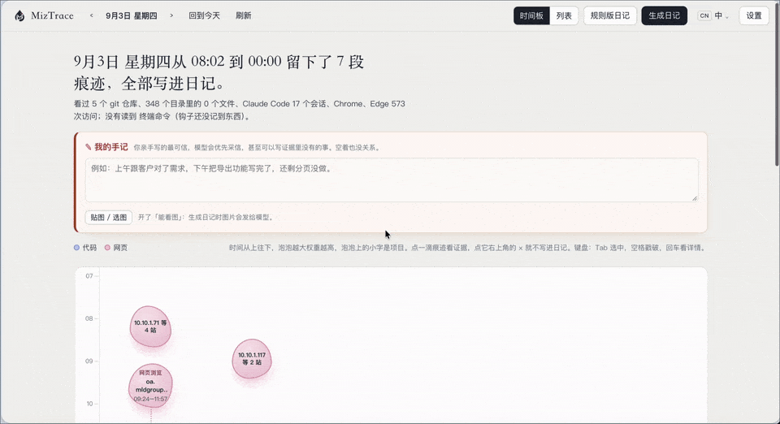
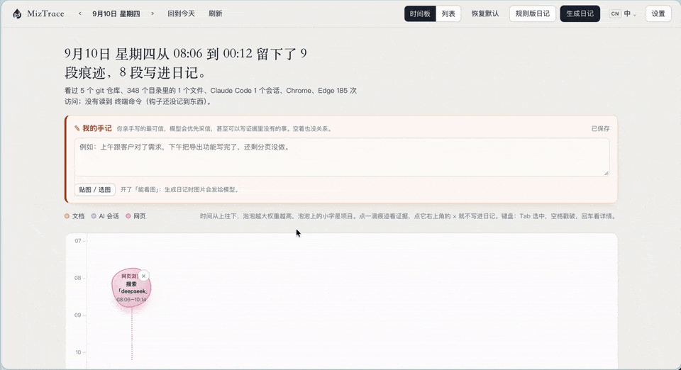

<p align="center"></p>
<h1 align="center">MizTrace（觅迹）</h1>
<p align="center">你今天到底做了什么？它替你记下来，写成一篇<b>每一句都能点回证据</b>的日记。</p>
<p align="center"><a href="./README.en.md">English</a></p>

---

一天下来，你改过的文件、提交的代码、问过 AI 的问题、翻过的网页、敲过的命令，散落在电脑各处。MizTrace 在本机把这些痕迹收集起来，铺成一张时间板；你戳掉不想写的、补上电脑不知道的，剩下的交给你自己配的模型，写成一篇像样的日记。

核心服务零第三方依赖，默认不联网，没有 API key 也能用。macOS 和 Windows 通用；桌面打包工具在独立的 `desktop/` 工程中管理。

## 下载桌面 App

**下面的固定入口始终下载 GitHub 上标记为 Latest 的最新正式版**，发布新正式版后无需修改链接。测试版、仅推送源码或尚未打包成功的标签不会替换这些下载入口。历史版本和更新内容可在 [Releases](https://github.com/MIZHOUCL/MizTrace/releases) 查看。

| 系统 | 下载入口 |
| --- | --- |
| Windows x64 | [下载最新安装程序](https://github.com/MIZHOUCL/MizTrace/releases/latest/download/MizTrace-Windows-x64-Setup.exe) |
| Mac Apple Silicon（M 系列芯片） | [下载最新 DMG](https://github.com/MIZHOUCL/MizTrace/releases/latest/download/MizTrace-macOS-arm64.dmg) |
| Mac Intel | [下载最新 DMG](https://github.com/MIZHOUCL/MizTrace/releases/latest/download/MizTrace-macOS-x64.dmg) |

**个人自用免费，企业统一部署、团队共享系统或对外商业服务需购买授权。** 个人独立使用写工作周报并提交给公司也免费。详见 [授权说明](./LICENSING.md)。

安装包内置运行环境，用户无需安装 Node.js。0.4.0 起支持在应用内查看新版本、发布日期与说明，自行决定下载；下载后可立即重启，或下次启动时更新。旧版需要一次覆盖安装以接入更新器。macOS 应用内安装需要 Developer ID 签名的版本。发布步骤见 [桌面打包与发布](./docs/桌面打包与发布.md)。

手动检查版本使用桌面菜单栏的 **更新 → 检查更新…**，入口位于「编辑、视图、窗口」旁。页面工具栏不再放置更新按钮。

macOS 如果提示“已损坏，无法打开”，请查看[macOS 安装故障说明](./docs/桌面打包与发布.md#已下载版本提示已损坏无法打开)。早期未签名安装包可能被系统拦截；后续正式发布必须通过 Developer ID 签名、Apple 公证和 Gatekeeper 检查。

## 一分钟跑起来

需要 Node 22.13 以上（或 23.4 以上）。没有任何第三方依赖，不需要 `npm install`。

```bash
git clone https://github.com/MIZHOUCL/MizTrace.git
cd MizTrace
node bin/miztrace.js ui
```

浏览器会自动打开一个只有你能访问的本地页面。第一次进来它会问你：去哪些目录找痕迹、读哪些来源。推荐目录、检测到的浏览器和 AI 工具都已经替你勾好，点「开始采集」就行。

想当成全局命令用：

```bash
npm link
miztrace ui
```

## 每天两分钟，三个动作

左侧提供「今日记录」「日记库」「周报 / 月报」三个功能入口。今日记录整理当天痕迹，日记库回看和编辑记录，周报 / 月报按项目汇总一段时间的进展。

### 生成周报与月报（0.5.0）

1. 打开「周报 / 月报」，选择本周、上周、本月、上月或自定义日期（最多 62 天），选用「工作汇报」「研发交付」「个人复盘」模板。
2. 加载素材并勾选本期日记、草稿或已保存手记。日记库里的外部 Markdown 文件需以 `YYYY-MM-DD` 开头命名，未标日期的文件不会按修改时间猜测归属。相同正文的同日副本自动去重，同日已有定稿时不默认选择旧草稿。
3. 预览将发送给模型的正文和覆盖日期，再确认生成。与每日痕迹写作不同，报告需要发送所选日记 / Markdown 的正文；未选记录、图片和原始工作文件不发送。大篇幅素材会分块处理，超出 6 万字符会明确提示缩小范围。
4. 报告按项目区分已完成、推进中、问题与计划。展开「核对事实与原文引句」回看依据；点击「编辑报告」进入日记库的 Markdown 编辑器，支持保存、历史版本、复制和导出。

生成分为事实提炼与整篇审核两步，再由固定模板排版。引用、引句和数字经过检查，兼容千分位、全角百分号及常见中文数量等写法。每步失败最多纠正一次；仍有问题时保留可核对的事实并标记为待核对草稿，具体问题与原文可在「生成检查」中查看。完全无法采用 AI 内容时保存为资料整理版供手动编辑，不把未通过的说法当作成果。所有调用（包括校验失败和重试）计入每日用量。

也可以选择「使用本地模板」，不调用模型，把素材放入待整理区。报告保存在独立的本地表中，不覆盖每日记录；重新生成保留旧报告。引句匹配无法证明所有语义判断正确，原日记本身的错误也可能被带入，分享前仍需核对。

### 回看和编辑历史日记



1. 点击左侧「日记库」，在列表底部点「管理日记目录」，直接选择一个或多个文件夹。这里汇总所选目录及子目录的 `.md` 文件、本地日记和生成草稿，与设置中的日记输出目录独立。移除目录只取消显示，不删除文件。
2. 按标题、日期、文件名搜索，选中一篇进入编辑器。支持编辑 / 分栏 / 预览，以及标题、粗斜体、列表、待办、引用、代码块、链接和基础表格。
3. 点击「保存」，或按 `Ctrl+S` / macOS `⌘S`。修改前保留历史版本；文件还会生成 `.bak` 备份。外部修改引起冲突时，先导出当前编辑，再重新打开最新版本合并。

点击「新建日记」即可直接手写，不需要配置模型或输出目录。新建内容先保存在本机数据库，需要文件时选择「导出 .md」。生成的日记可通过「保存并编辑」进入日记库继续修改。

历史列表顶部的箭头可单独收起列表，为编辑器腾出空间。设置窗口立即打开，来源探测在后台完成并缓存；模型连接测试显示等待时间，最长探测 15 秒。

切换功能模块会保留编辑中的内容；打开另一篇日记或关闭页面时，未保存的修改会得到提醒。历史版本载入编辑器后，需要再次保存才会恢复。手动编辑的内容需要重新核对事实，不能直接视为已核验成果。

日记库第一版支持 UTF-8 Markdown，单文件上限 512 KiB。搜索暂不检索正文；图片语法显示说明，不加载远程图片。完整范围和后续步骤见 [开发进度](./docs/开发进度.md)。

### 整理今日记录

打开页面，今天的痕迹已经铺在时间板上：时间从上往下，一个泡泡就是一段连续的工作，越大权重越高，点开能看到它背后的每一条证据。你要做的只有三件事。

### 1. 电脑不知道的事，自己写两句

<p align="center"></p>

开了个会、打了个电话、想通了一件事，这些在电脑上没有痕迹。在「我的手记」里随手写一句，需要就贴张图（截图、白板照片都行）。手记是最高优先级的证据：模型优先采信，甚至可以写证据里没有的事。空着也没关系。

### 2. 电脑只知道一半的事，补一句说明

<p align="center"></p>

浏览记录只知道你在 bilibili 待了 36 分钟，不知道你在干什么。点开泡泡，在「补充说明」里告诉它「在找英语素材练听力」，日记就这么写，而不是一句干巴巴的「浏览了 bilibili」。补充说明和手记同级，也能附图。

### 3. 不想写进日记的，戳掉

<p align="center"></p>

私事、摸鱼、跟工作无关的搜索，点泡泡右上角的 ×，或者抽屉里的「不写进日记」。泡泡变成虚线、标题里的计数减一，底部有「撤销」，点 ↺ 随时恢复。某个项目永远不想出现？抽屉里有「永久排除此项目」。

最后点「生成日记」。发送前你能看到将要发给模型的每一个字，确认后一两分钟写好；不满意换个模板重写。没配模型也有「规则版日记」，一样能保存。

<details>
<summary>生成的日记长什么样（示例）</summary>

```markdown
# 2026-09-10

## 今日概览

- 上午和三家供应商开会，对了第三方服务的范围和报价，下周出对比表。
- 导出功能的分页做完并合入；CI 翻红查清是测试写死了本地时区，改成固定时区后全绿。
- 傍晚在 bilibili 找英语听力素材，练了半小时。

## 过程

**上午：供应商会议** 10:00 三家供应商轮流过方案，分歧集中在按量计费的阶梯，会后把三家的报价整理进了对比表的草稿。

**下午：分页与 CI** 14:20 起在 export 分支上补分页，15:40 提交后 CI 翻红。让 Claude Code 排查，它发现两个测试把 08:00Z 写死成了上海时间的 16:00，GitHub 的机器用 UTC 算出来对不上；把测试钉在固定时区后 167 个用例全过，17:05 合入。

**傍晚：英语** 23:23 起在 bilibili 看「这样练英语听力」系列，约 36 分钟。
```

落盘的文件就是这样一篇干净的 Markdown。网页里每一段旁边还挂着它引用的证据，点一下就能看是哪次提问、哪个文件、哪个网页。

</details>

## 它为什么值得用

**别的工具让你回忆，它把证据摆在你面前。** 日报难写不是因为不会写，是因为记不清。MizTrace 读的是真实发生过的事：git 提交、改动过的文件、AI 会话里你问了什么和它最后答了什么、浏览记录（含停留时长）、终端命令。你只需要做选择题。

**每一句话都能点回来源。** AI 写的每一段都对应几条证据，模型编不出证据里没有的事，编了也会被标出来。落盘的文件是干净的日记，不带脚注。

**懂 AI 工具，而且懂得多。** Claude Code、Codex、Gemini CLI、Cursor、Cline、Windsurf、Trae、opencode、aider、Copilot 等 25 种，读你的提问和 AI 的最终回复。日记里会写「我让 Codex 改了 X，它把 Y 换掉了」，而不是笼统的「用了 AI」。

**日记像日记，不像流水账。** 两层：先是几条「今日概览」，一眼知道做成了什么；再是第一人称的「过程」，卡在哪、怎么解决的，留给以后的自己。四个内置模板（总结型、时间线、复盘型、极简）可选，也能自己改。

**不写代码也能用。** 一天都在做表格、写方案、开会？文档大纲、浏览记录、手记同样能撑起一篇日记。

**记录保存在本机。** 痕迹采集只读指定目录的元信息和文档大纲；日记库会读取你选定目录中的 Markdown 正文以供编辑。浏览器和终端采集默认关闭，模型发送需要确认。桌面版默认启动时向 GitHub 检查版本，可在更新窗口关闭；检查不上传日记，下载需要手动确认。受管设备配置可禁止联网。中英文界面一键切换。

## 它读什么

| 来源 | 读到的 | 默认 |
|---|---|---|
| git | 当日提交、工作树改动、今天 clone 的仓库 | 开 |
| SVN | 工作副本里的当日提交、本地未提交改动 | 关 |
| 文件 | 指定目录下今天改过或新出现的文件（只记路径和时间）；docx / xlsx / pptx / md / pdf 另读大纲 | 开 |
| AI 会话 | 你的提问、AI 执行的命令 / 改的文件、每轮最终回复的前 300 字 | 开 |
| 手记 | 你自己写的几句话和贴的图 | 开 |
| 浏览器 | 页面标题、去掉参数的地址、搜索词、停留时长（Chrome、Edge、Safari、Firefox、Arc 等） | 关 |
| 终端 | 你敲的命令和所在目录（装一段 shell 钩子） | 关 |

`miztrace sources` 会列出这台电脑上实际能读到什么，包括扫描目录下有哪些 SVN 工作副本。

SVN 默认关着，原因很具体：`svn log` 是向版本库服务器发起的查询，而 git log / git status 全在本地。打开后也只读 revision、作者、时间、提交说明和改动路径，不读 diff 正文。只想记录本地未提交改动、完全不联网，就再关掉 `svn.remote`。

## 常用命令

| 命令 | 作用 |
|---|---|
| `miztrace ui` | 打开网页：今日记录、日记库、Markdown 编辑、设置 |
| `miztrace today` | 在终端直接输出今天的规则版日记 |
| `miztrace date 2026-09-03` | 指定日期 |
| `miztrace week` | 最近 7 天汇总 |
| `miztrace write` | 命令行里用 AI 写日记，`--preview` 只看将发送的内容 |
| `miztrace sources` | 本机能读到哪些来源 |
| `miztrace shell-hook --install` | 装上记录终端命令的钩子 |
| `miztrace where` | 数据目录与配置路径 |
| `miztrace purge --yes` | 删除全部本地数据 |

常用选项：`--root <目录>`（可重复，最重要的一个）、`--out <目录>`（日记写到哪，可以是 Obsidian 库）、`--author <名字或邮箱>`（公共仓库里只算自己的提交）、`--tz Asia/Shanghai`、`--cutoff 4`（凌晨四点前算前一天）、`--no-svn`（这一次不采 SVN）。

## 配置模型

网页右上角「设置」里填三样：Base URL、API key、模型名。DeepSeek、智谱、Moonshot、通义、OpenRouter、Ollama 都是 OpenAI 兼容协议，填到 `/v1` 为止；Anthropic 协议按 URL 自动识别。点「测试连接」通了就行，没有别的开关。

模型名用服务商的**稳定名字**（DeepSeek 是 `deepseek-chat`，推理版 `deepseek-reasoner`）。名字里带 `expires` / `preview` 的限时模型下线后，服务常常仍返回 200 但内容为空，MizTrace 会报「模型返回了空内容」并提示换模型。带思考的模型（DeepSeek V4 flash / reasoner、o 系列）会把「最大输出」先花在思考上，预算小了正文一个字都出不来。MizTrace 发现这种情况会自动加大预算重试一次（带思考至少 16000，普通截断至少 8000），成功后把这个数存回设置，下次一次成功。OpenAI 推理模型那套 `max_completion_tokens`、不接受 `temperature` 的差异也会按 400 里的提示自动适配。

多模态模型勾上「模型支持图片」，手记和补充说明里的图就会发原图。

## 隐私细则

- 只读 `--root` 下的目录和各 AI 工具自己的会话目录。跳过点文件、`node_modules`，以及 `.env` / `*.pem` / `id_rsa` 这类文件（连路径都不记）。
- 唯一的例外是 SVN：它默认关着，打开后 `svn log` 会向版本库服务器发一次查询（git 不需要，全在本地）。`svn.remote: false` 可以只读本地改动。
- 文件只记路径、时间、大小；文档只读标题层级 / 工作表名 / 页标题。
- 会话不读思考过程、工具输出、代码块正文。
- 终端命令里带 `password=`、`token=`、`export XXX_KEY=` 的连本地库都不进。
- 发送前做家目录替换、邮箱 / 手机号 / IP 替换；疑似密钥直接熔断，不发。
- 出站请求只在 `src/ai/`，本地服务只在 `src/server/` 且只绑 127.0.0.1，CI 用 grep 守着这两条边界。
- `config.json` 里 `managedDevice: true` 可永久禁用一切外发，网页里故意不提供这个开关。

数据目录：macOS `~/Library/Application Support/miztrace`，Windows `%APPDATA%\miztrace`；`MIZTRACE_DATA_DIR` 可覆盖。

## 路线图：从「记下来」到「用起来」

MizTrace 现在做的是把每一天记准。日记攒多了，它能做的远不止回看。计划分三步：**记**（现在）→ **攒**（把日记攒成你的能力档案）→ **用**（让档案替你干活）。

| 阶段 | 模块 | 一句话 | 状态 |
|---|---|---|---|
| 记 | 每日日记 | 痕迹 → 时间板 → 日记，每句可点回证据 | 已可用 |
| 记 | 插件化 | 新来源、新输出，扔个文件进去就生效 | 规划中 |
| 记 | Obsidian 插件 | 在 Obsidian 里采集、戳泡泡、生成，日记直接进库 | 规划中 |
| 攒 | 我的技能 | 从日记里长出来的能力档案，每项技能都有证据 | 规划中 |
| 用 | 精准狙击 | 贴一段 JD，一键生成只写真事的定向简历 | 规划中 |
| 用 | 周报 / 月报 | 选择日记与手记，提炼事实、审核、按模板汇报 | 已可用 |
| 用 | 年终总结 | 汇总长期成果与成长轨迹 | 规划中 |

### 插件化：来源和输出都能插

现在 25 种 AI 工具的适配器都在 `src/collect/providers/` 里，新加一种要改核心代码。计划把「来源」和「输出」做成两个插件契约：一个来源插件就是一个目录，实现 `detect()` 和 `collect()`，放进插件目录就生效；输出插件同理，日记可以落到 Obsidian、Logseq、Notion、飞书文档，或者你自己的地方。新工具出来当天就能有人写好适配器，不用等版本。

### Obsidian 插件：日记直接进你的库

现在已经能用 `--out` 把 Markdown 写进 Obsidian 库。下一步做成 Obsidian 插件：在 Obsidian 里点一下就采集、戳泡泡、生成，不用再切到浏览器。日记带上 frontmatter（日期、项目、标签），手记里的图进附件目录，项目名自动双链到项目笔记，用 Dataview 就能查「这个月碰了哪些项目」「哪天在做 X」。

### 我的技能：日记攒出来的能力档案

一天的日记是「做了什么」，一百天的日记就是「会什么」。这个模块定期读你的日记，把反复出现的东西归成技能：Vue、PostgreSQL 调优、跨团队推动、英语听力……点进任何一项，能看到三样东西：

- **掌握到什么程度**：最近三个月碰了多少次、做到多深、是主导还是参与。
- **凭什么说你会**：哪几天的日记、哪几次提交、哪几段 AI 会话。还是那条铁律，每一条都能点回证据，没证据的技能不会出现。
- **怎么长起来的**：一条时间线，从第一次接触到现在。

副产品：半年没碰的技能会变灰，提醒你它在荒废。

### 精准狙击：一份 JD，一份简历

有了技能档案，你这个人的全部能力就都在本机的库里了。贴一段岗位 JD，它按 JD 的每条要求从档案里挑最匹配的技能和事迹，一键生成一份为这个岗位定制的简历（Markdown / PDF），每条经历后面附上证据来源，你核对完再投。

顺带生成**面试弹药**：JD 里每条要求对应你做过的一件真事，按「背景、任务、动作、结果」整理好，直接拿去答「讲一个你解决过的难题」。

它不会编造：档案里没有的能力，简历上不会出现。这正是它比拿通用 AI 改简历靠谱的地方，也是你敢把这份简历投出去的原因。

### 其他想做的

- **周报 / 月报 / 年终总结**：从每日日记往上汇总。`miztrace week` 现在只有规则版，接上模型就是一份能直接交的周报；年终自评同理。
- **时间去哪了**：按项目、类别、工具统计一周的时间分布，把「感觉很忙」变成「四成时间在修 bug」。
- **更多来源**：日历里的会议、Windows 前台窗口采样、IDE 活动。规矩不变，只记标题和时间，不读内容。
- **安静采集**：常驻菜单栏 / 托盘，每天晚上自动采集，提醒你花两分钟看一眼。
- **多机合并**：公司电脑和家里电脑的痕迹合到同一天里。

后续模块继续在本机处理记录，模型发送需要确认；桌面版的 GitHub 版本检查由更新窗口单独控制。自动生成的事实应能回到来源核对。哪个模块你最想要，或者想认领，来 issue 里说一声。

## Community
[linux.do](https://linux.do/) - A thriving developer community.

## 开发

```bash
npm test
```

测试统一钉在 Asia/Shanghai 时区跑（`scripts/pin-timezone.mjs`），所以在 UTC 的 CI 和任何时区的机器上结果一致。

`src/collect/` 采集，`src/modules.js` 聚成模块，`src/ai/` 写作（唯一允许出站），`src/server/` 本地服务（唯一允许监听），`web/` 无构建的 Vue 前端。

新的 AI 工具适配欢迎提 issue，附一份脱敏后的会话样例文件就能加。

## 许可

从 0.5.1 起使用 [MizTrace Personal Use and Commercial License](./LICENSE)：个人自用免费；企业统一部署、团队共享系统或对外商业服务需购买授权。个人工作日记、周报及导出的文档可以提交给公司或客户。

商业咨询：[2907638436@qq.com](mailto:2907638436@qq.com)。完整使用边界见 [授权说明](./LICENSING.md)。0.5.0 及此前已按 MIT 发布的副本继续适用 [原 MIT 许可](./LICENSE-MIT)，第三方组件保留其原有许可证。
